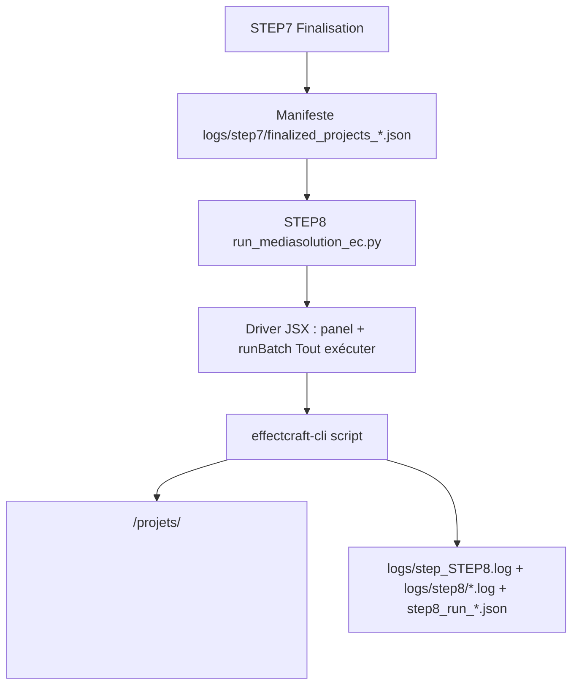
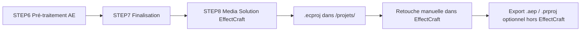

# Media Solution (EffectCraft)

**TL;DR** : Génère les projets EffectCraft `<video>_9x16.ecproj` (recadrage vertical 9:16, recentrage par segment, découpes CSV) en pilotant `MediaSolution.jsx` via `effectcraft-cli` — en **headless** avec EffectCraft ≤ 0.7.0, en pilotant **l'application ouverte** (`--bridge`) à partir de 0.8.0. Dernière étape du pipeline 8 étapes.

## Le Problème : Post-Production EffectCraft Manuelle

Après la finalisation (étape 7), les dossiers projet sont publiés dans `/mnt/cache` avec leurs `docs/` (vidéos, CSV, tracking). Jusqu'ici, il fallait ouvrir EffectCraft, lancer le panel **Media Solution**, détecter/cocher les dossiers, lancer le batch puis vérifier chaque `projets/<video>_9x16.ecproj` — une opération répétitive et non traçable par le workflow.

## Notre Solution : Batch Headless Piloté par Manifeste

L'étape 8 s'appuie sur trois briques :

1. **Le manifeste de l'étape 7** — `logs/step7/finalized_projects_<horodatage>.json` liste les dossiers effectivement copiés par le run courant (nom + chemin final). L'étape 8 lit le plus récent : elle ne traite donc que les projets publiés par la session, pas tout le cache.
2. **Le driver headless** — `workflow_scripts/step8/run_mediasolution_ec.py` concatène `scripts/MediaSolution-EC/MediaSolution.jsx` (les scripts EffectCraft ne peuvent pas s'inclure entre eux) avec un driver généré qui ouvre la préférence scripting, applique la config du panel et appelle `runBatch`.
3. **`effectcraft-cli script`** — un process dédié par run, avec deux modes d'exécution : **headless** (≤ 0.7.0, totalement autonome) ou **bridge** (≥ 0.8.0, le driver tourne dans l'application ouverte qui porte la préférence scripting ; l'application est lancée automatiquement si elle n'écoute pas).

### Flux complet



### Mode « Tout exécuter » uniquement

Le mode **« Pas-à-pas »** du panel n'existe que pour l'UI interactive (un projet par handler ScriptUI). L'étape 8 utilise **un seul appel `runBatch(..., maxUnits = 0)` synchrone** : tous les dossiers du manifeste sont traités d'affilée, projet après projet. Ne jamais passer `maxUnits > 0` : le batch resterait « en cours » et aucun appel ultérieur ne pourrait le reprendre.

### Mode d'exécution : headless ou bridge

| EffectCraft | Mode | Pourquoi |
|---|---|---|
| ≤ 0.7.0 | `headless` | `effectcraft-cli script` autonome ; le driver active la préférence scripting lui-même. |
| ≥ 0.8.0 | `bridge` | 0.8.0 refuse qu'un script s'octroie les droits d'écriture ; le driver doit tourner dans **l'application ouverte**, qui charge la préférence de l'utilisateur. |

`STEP8_MODE=auto` (défaut) détecte la version du CLI : headless < 0.8.0, bridge sinon
(`STEP8_MODE=headless|bridge` force le mode). En mode bridge, le wrapper :

1. vérifie si une instance écoute sur le port (`STEP8_BRIDGE_PORT`, défaut 9877) ;
2. sinon, **lance l'application** (`STEP8_EFFECTCRAFT_APP`, défaut `effectcraft`) avec
   `--control <port> --empty` et attend que le canal réponde (`STEP8_APP_LAUNCH_TIMEOUT`, défaut 60 s ;
   log `logs/step8/app_launch_<ts>.log`) — l'application reste ouverte après le batch (retouche) ;
   `STEP8_AUTO_LAUNCH_APP=false` ou `--no-launch-app` rétablit l'erreur explicite à la place ;
3. exécute le pré-vol `prefs.set scripting.allowScriptsWriteFiles` **via le bridge** (commande hors
   contexte script, donc autorisée), puis le batch.

Prérequis : la préférence « Allow Scripts to Write Files and Access Network » doit être active dans
l'application (Préférences ▸ Scripting & Expressions) — le pré-vol tente de l'activer.

## Utilisation Rapide

### Lancement via l'interface

```
# Carte « 8. Media Solution (EffectCraft) » → Lancer
# ou séquence complète : « ✨ Lancer le Workflow Complet (1-8) »
```

### Lancement via API

```bash
curl -X POST http://localhost:5003/run/STEP8
```

### Exécution manuelle (debug)

```bash
# Avec le manifeste du dernier run de l'étape 7 :
/mnt/venv_ext4/env/bin/python workflow_scripts/step8/run_mediasolution_ec.py

# Sans rien exécuter (affiche dossiers, config et driver généré) :
/mnt/venv_ext4/env/bin/python workflow_scripts/step8/run_mediasolution_ec.py --dry-run

# Sur un dossier précis, hors manifeste :
/mnt/venv_ext4/env/bin/python workflow_scripts/step8/run_mediasolution_ec.py --folder "/mnt/cache/117 Camille"
```

Options utiles : `--manifest <chemin>`, `--folder <chemin>` (répétable), `--cli <binaire>`,
`--panel-jsx <MediaSolution.jsx>`, `--config-json <mediasolution_ec.json>`,
`--mode <auto|headless|bridge>`, `--bridge-port <port>`, `--dry-run`.

### Résultat attendu

```
/mnt/cache/117 Camille/
├── docs/                               # entrées (vidéos, CSV, tracking)
└── projets/
    ├── <video1>_9x16.ecproj            # projet EffectCraft généré
    └── <video2>_9x16.ecproj
```

Chaque comp reçoit : comp 1080×1920, anchor top-centre, position `[540, 0]`, échelle 180 %,
recentrage par segment depuis le tracking (`_ae.json` > `_tracking.json` > `.json`), segments
issus du CSV (snap 1,5 frame) et un objet nul « Null Segments » qui parente les segments.

## Configuration

### Variables d'environnement (`.env`)

```bash
# Timeout du batch (secondes) — un batch EffectCraft peut être long (défaut : 14400 = 4 h)
STEP8_TIMEOUT=14400

# Exécutable EffectCraft (nom dans le PATH ou chemin absolu)
STEP8_EFFECTCRAFT_CLI=effectcraft-cli

# Panel source (défaut : scripts/MediaSolution-EC/MediaSolution.jsx du dépôt)
# Repli automatique si absent : ~/.config/effectcraft/Scripts/ScriptUI Panels/MediaSolution.jsx
STEP8_PANEL_JSX=

# Config du panel à appliquer (défaut : <output_dir du manifeste>/mediasolution_ec.json)
STEP8_PANEL_CONFIG=

# Mode d'exécution : auto (défaut), headless ou bridge (application ouverte — requis en 0.8+)
STEP8_MODE=auto

# Port du control channel de l'application en mode bridge
STEP8_BRIDGE_PORT=9877

# Lancement automatique de l'application si le canal n'écoute pas (mode bridge)
STEP8_AUTO_LAUNCH_APP=true

# Exécutable de l'application (nom dans le PATH ou chemin absolu)
STEP8_EFFECTCRAFT_APP=effectcraft

# Délai d'attente du canal après lancement de l'application (secondes)
STEP8_APP_LAUNCH_TIMEOUT=60
```

### Config du panel (`mediasolution_ec.json`)

En headless, le script ne lit pas lui-même `<racine>/mediasolution_ec.json` : le wrapper le charge
et le pousse via `applyConfig`. Les réglages du panel sont donc respectés tels quels
(`enableCuts`, `enableAutoRecentering`, `enableLogFile`, `reuseExistingProjects`, tailles cibles…).
Modifier `reuseExistingProjects: true` permet de repartir des `.ecproj` existants au lieu de les recréer.

### Préférence scripting

Sans `Allow Scripts to Write Files and Access Network`, ni la lecture des CSV/tracking, ni
`app.project.save()` ne fonctionnent. Le driver appelle
`app.run("prefs.set", { key: "scripting.allowScriptsWriteFiles", value: true })` avant le batch.

- **≤ 0.7.0 (headless)** : l'appel est accepté, la préférence est activée pour la session.
- **≥ 0.8.0 (bridge)** : un script ne peut plus modifier cette permission ; le wrapper exécute un
  pré-vol `effectcraft-cli exec prefs.set` **via le bridge** (hors contexte script), et
  l'application doit avoir la préférence active (Préférences ▸ Scripting & Expressions).

## Monitoring et Logs

| Sortie | Contenu |
|---|---|
| `logs/step_STEP8.log` | Sortie brute du CLI + lignes normalisées (log live de l'UI) |
| `logs/step8/mediasolution_<ts>.log` | Log du wrapper (manifeste, dossiers, décision finale) |
| `logs/step8/step8_run_<ts>.json` | Rapport JSON du run (dossiers, résultat `runBatch`, code retour, durée) |
| `logs/step8/drivers/step8_driver_<ts>.jsx` | Driver concaténé (10 plus récents conservés, audit/debug) |
| `<dossier>/MediaSolutionLog_V12.0_EC_<ts>.log` | Log par dossier projet si `enableLogFile: true` |

Lignes normalisées lues par le parseur de progression du backend :

```
MS_BATCH_TOTAL: 12
MS_BATCH_PROGRESS: 3/12 - clip1.mp4
MS_BATCH_OK: clip1_9x16.ecproj
MS_BATCH_FAIL: clip2.mp4
MS_BATCH_RESULT: {"ok":true,"total":12,"processed":12,"unitIndex":12,"running":false,"errors":[]}
```

Le succès de l'étape est décidé sur `MS_BATCH_RESULT` : `ok: true` **et** aucune erreur.

### Annulation

Le bouton « Annuler » envoie `SIGTERM` au wrapper, qui termine le process `effectcraft-cli` enfant
(le batch s'arrête entre deux projets : il n'y a pas d'annulation *pendant* un projet). En mode
bridge, l'application EffectCraft n'est pas fermée par l'annulation.

## Résolution de Problèmes

### « Aucun manifeste de l'étape 7 trouvé »

L'étape 7 n'a jamais tourné (ou `logs/step7/` a été purgé). Lancer l'étape 7 d'abord, ou passer
`--folder` pour traiter un dossier précis.

### « Aucun projet à traiter »

Le manifeste est présent mais vide : l'étape 7 n'a finalisé aucun projet (déjà le cas d'un run
sans projet prêt). L'étape 8 se termine alors en succès, sans rien générer.

### EffectCraft introuvable

`STEP8_EFFECTCRAFT_CLI` ne pointe sur rien d'exécutable. Vérifier `which effectcraft-cli` et la
variable d'environnement.

### « EffectCraft n'écoute pas sur 127.0.0.1:9877 »

L'application n'est pas lancée et son lancement automatique est désactivé
(`STEP8_AUTO_LAUNCH_APP=false` ou `--no-launch-app`). Lancer `effectcraft --control 9877` (ou
définir `STEP8_BRIDGE_PORT`), puis relancer l'étape 8.

### « Scripts can't change what scripts are allowed to do »

EffectCraft ≥ 0.8.0 : la préférence scripting doit être active **dans l'application**
(Préférences ▸ Scripting & Expressions). Le pré-vol du wrapper tente de l'activer via le bridge ;
si le message persiste, l'activer à la main dans l'application.

### Un dossier est ignoré

Le dossier listé n'existe plus, ou n'a pas de sous-dossier `docs/`. Le wrapper loggue un
avertissement et retire le dossier du batch ; le panel fait de même pour les dossiers invalides.

### Le batch dépasse le timeout

Ajuster `STEP8_TIMEOUT` (secondes) dans `.env`. À l'expiration, le backend termine le process
(étape marquée en échec, code -9).

### Les `.ecproj` ne sont pas écrits

Vérifier la préférence scripting (activée par le driver ≤ 0.7.0, par pré-vol bridge ≥ 0.8.0 ; un
dossier non inscriptible reste bloquant) et les logs `logs/step8/mediasolution_*.log` /
`step8_run_*.json` (`result.errors`).

### Reprendre après un échec partiel

Relancer l'étape : par défaut les `.ecproj` existants sont **écrasés** (comportement du panel).
Avec `reuseExistingProjects: true`, les projets existants sont rouverts et complétés.

## Intégration Pipeline



- Les exports `.aep` / `.prproj` **ne font pas partie** de l'étape 8 : ils restent assurés par les
  raccourcis `Export-AEP-Camille.desktop` / `Export-PRPROJ-Camille.desktop`
  (`scripts/MediaSolution-EC/tools/`).
- L'étape 8 est incluse dans la séquence complète (« Workflow Complet 1-8 ») et reste lançable
  individuellement.

---

## Golden Rule

**L'étape 8 ne traite que ce que l'étape 7 a publié : si le manifeste est vide, il n'y a rien à générer — vérifie d'abord la finalisation, pas EffectCraft.**
