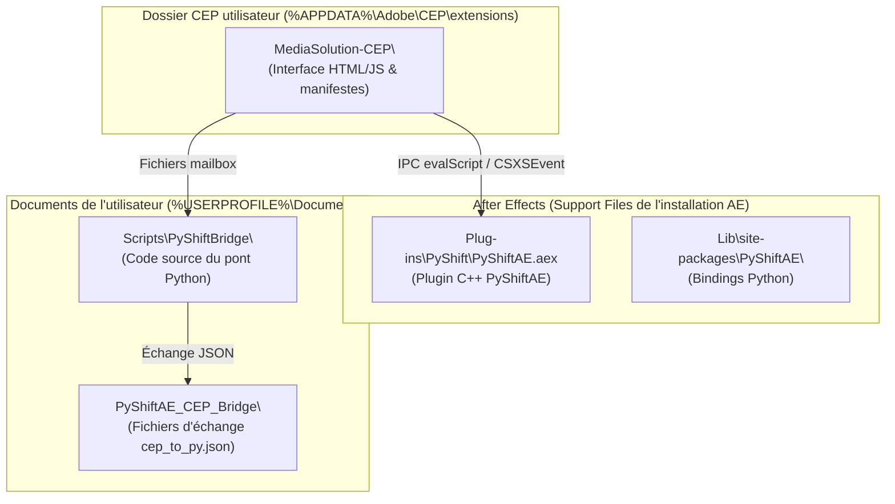

# Cartographie des dossiers

**TL;DR** : l'extension vit dans le dossier CEP utilisateur, le pont Python dans `Documents\Scripts\PyShiftBridge`, et les deux échangent par mailbox dans `Documents\PyShiftAE_CEP_Bridge`. Chaque pièce a un rôle précis, et ce document explique pourquoi elles sont séparées.

## Le schéma global

## Les cinq dossiers, et pourquoi ils existent

1. **`%APPDATA%\Adobe\CEP\extensions\MediaSolution-CEP\`** — l'extension elle-même : le panel (HTML/CSS/JS dans `client/`) et le script hôte (`host/MediaSolution.jsx`). C'est le point d'entrée utilisateur, exécuté dans le Chromium embarqué d'AE. C'est le seul dossier que ce repo déploie.

2. **`<dossier AE>\Support Files\Plug-ins\PyShift\PyShiftAE.aex`** — le plugin C++ PyShiftAE (v1.0.1 depuis la migration du 14/07/2026; l'ancien v0.1.1 est conservé en `.aex.v0.1.1.BAK`). Il fournit les bindings Python internes d'AE. Avec la v0.1.1, aucun serveur de pipe nommé n'était fourni : le transport effectif est le mode mailbox. Le support du pipe CEPy avec la v1.0.1 reste à valider.

3. **`<dossier AE>\Support Files\Lib\site-packages\PyShiftAE\`** — le package Python contenant `PSCAE.pyd` (la DLL de binding). Permet `import PyShiftAE` quand Python tourne en mode interne (CEPy).

4. **`%USERPROFILE%\Documents\Scripts\PyShiftBridge\`** — le code source du pont (`bridge_daemon.py`, `bridge_oneshot.py`, package `mediasolution/`). Tous les calculs lourds de cuts et de recentrage. Il vit hors du dossier CEP volontairement : ça évite de polluer l'extension et ça permet de le réutiliser depuis d'autres scripts ou interfaces.

5. **`%USERPROFILE%\Documents\PyShiftAE_CEP_Bridge\`** — la boîte aux lettres : `cep_to_py.json` et `py_to_cep.json` échangés entre ExtendScript et le démon, plus `daemon_loop.log`. Un simple dossier de transit.

## Pourquoi la séparation extension / pont

Le plugin PyShiftAE appartient à l'installation d'After Effects, le pont Python au code réutilisable de l'utilisateur, et l'extension au dossier CEP. Si le pont vivait dans l'extension, chaque mise à jour du panel écraserait ou orphelinerait le code Python, et le pont ne serait pas réutilisable ailleurs. La mailbox, elle, ne contient que des fichiers temporaires : elle peut être vidée sans risque.

La migration v0.1.1 → v1.0.1 (14/07/2026) se fait côté plugin et côté bindings (`PyShiftBridge/tools/migrate_to_1.0.1.py`), sans toucher au repo de l'extension.
