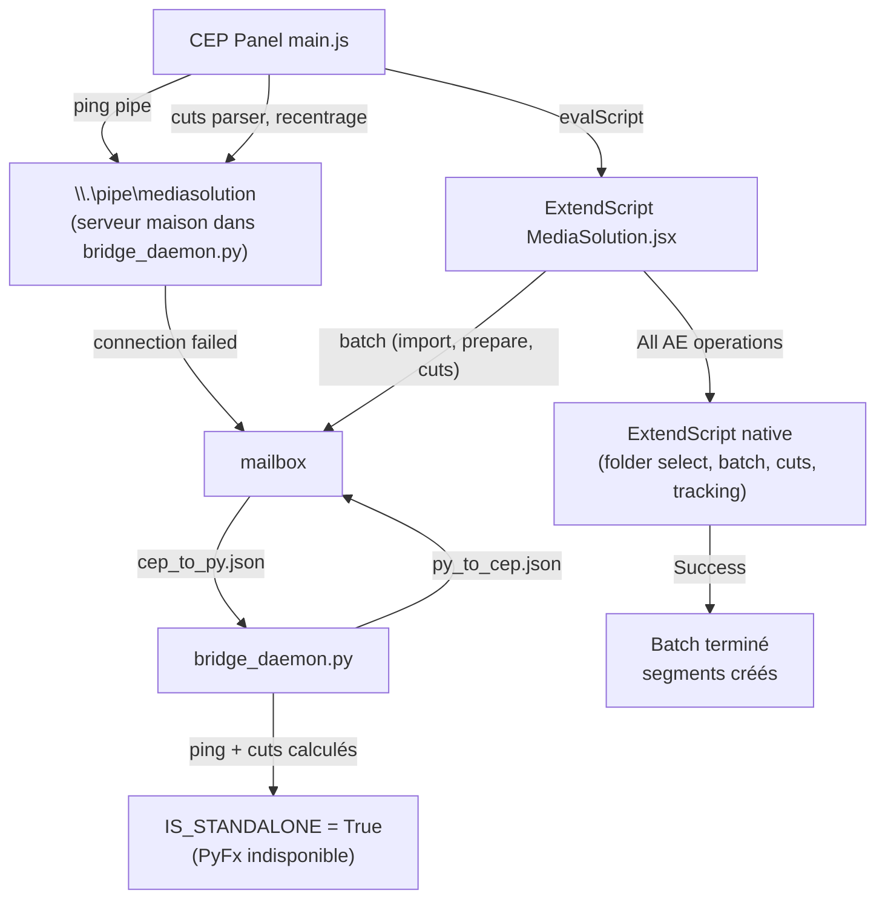

# Diagnostic du pont PyShiftAE : le pipe CEPy n'existe pas

**TL;DR** : PyShiftAE v1.0.1 (comme la v0.1.1) ne crée aucun pipe nommé CEPy — le support CEPy du plugin se limite à lancer `entry.py` comme panel Python ancré, sans transport client↔plugin. Le batch fonctionne en ExtendScript natif avec les cuts calculés par le démon Python. **Depuis le 07/08/2026**, un serveur de pipe nommé maison (`\\.\pipe\mediasolution`) a été ajouté au daemon : le client le détecte au health check et bascule automatiquement pipe ↔ mailbox.

## Ce que l'investigation a établi

Le bootstrap v2 du pont se charge correctement (ligne 12913 du log) :

```
[20:46:19] === Demarrage de PyShiftBridgeBootstrap.jsx (v2 CEPy) ===
[20:46:22] Diagnostic termine. CEPy pipe attendu: \\.\pipe\mediasolution
```

Mais aucun pipe `mediasolution` n'apparaît dans la liste des 370 pipes du système. Le panel retombe donc sur la mailbox, ce qui est le comportement prévu.

## La cause racine

**Aucune version de PyShiftAE (ni v1.0.1, ni v0.1.1) n'implémente de pipe nommé CEPy.** L'analyse du code source du tag 1.0.1 (jan 2024) l'a confirmé :

| Élément | v1.0.1 (jan 2024) | v0.1.1 (déc 2024, rework) |
|---|---|---|
| Module `PyShiftCore` | Existant | Supprimé, remplacé par `pyshiftae` + `PyFx` |
| Classe `Manifest` | Existant dans `PyShiftCore` | Inexistante |
| Pipe server CEPy | **Non créé** (le `CreatePipe` du binaire est un pipe anonyme de redirection stdout) | **Non créé** |
| Vrai IPC externe | `boost::message_queue` `PyC21`/`PyR21` (pas JSON) | Aucun |
| Docs CEPy | Incluses | "Docs are NOT updated as of yet" |

Le changelog du 12.22.24 le dit noir sur blanc : *"Reworked PyShiftAE. Closer to metal, lower latency... Reset version to 0.1.0. NOTE: Docs are NOT updated."* Et celui du 1.24.24 : *"Removed JS communication (will replace later)"* — le remplacement n'est jamais arrivé dans le .aex.

Les pipes `python-pipe-*` visibles dans la liste sont l'IPC **interne** du plugin C++ (entre le thread Python embarqué et le thread principal d'AE), pas accessible de l'extérieur.

## Ce qui a été corrigé en chemin

### Verrouillage de fichiers du daemon

Les erreurs récurrentes dans `daemon_loop.log` :

```
[WinError 32] Le processus ne peut pas accéder au fichier... py_to_cep.json.tmp -> py_to_cep.json
[Errno 13] Permission denied: py_to_cep.json.tmp
```

`_atomic_write_text()` (bridge_daemon.py, ligne 78) gère désormais :

- **3 retries** sur l'écriture du `.tmp`, avec cleanup du fichier stale et délai de 50 ms
- **5 retries** sur `os.replace()`, délai de 50 ms (le cas où ExtendScript lit `py_to_cep.json` au même moment)
- **Fallback** : écriture directe non-atomique si tous les retries échouent (mieux que planter)

### Gels AE en batch (août 2026)

Sept causes, sept correctifs :

1. **`myJSON.parse` destructif** (cause racine des gels) : une tentative de suppression du `eval` avait introduit une regex qui supprimait les lettres des chaînes JSON. Toutes les réponses du daemon étaient corrompues, le host les considérait en échec, le fallback ExtendScript lourd gelait AE. Retour au `eval` validé strictement par `rx_one` : la validation garantit du JSON pur, aucun code exécutable.
2. **Encodage BOM** : le daemon écrivait `py_to_cep.json` avec BOM, illisible pour le host. Écriture sans BOM + `safeJsonParse` robuste aux deux formes (BOM unicode et mojibake ``).
3. **`sendToCEP` dépendait du global `JSON`** : après suppression de `var JSON = myJSON;`, le test `typeof JSON` échouait ("JSON object missing in ExtendScript"). Sérialisation directe via `myJSON.stringify`.
4. **Polling client concurrent** : `updateActiveTarget` (10 s) et health check (30 s) envoyaient des `evalScript` pendant que le host manipulait `app.project` (close/open) → gel natif. **Polling suspendu pendant le batch.**
5. **`applyComputedCutsToLayer` utilisait `app.project.activeItem`** : sans viewer ouvert, la comp active était null → "Active item is not a comp" → cuts jamais appliqués. La comp du batch est désormais passée en paramètre.
6. **`openInViewer()` retirés du flux batch** : l'ouverture de viewers déclenchait le rendu de comps lourdes pendant le traitement.
7. **Logs disque activés** : `initLogFile()` au démarrage du batch (`MediaSolutionLog_V12.0_CEP_*.log` dans le dossier projet), avec flush immédiat des étapes critiques. L'écriture est pilotée par l'option « Fichier de logs de session » (options avancées du panel, activée par défaut) : décochée, elle coupe le fichier sans couper les logs du panneau.

Résultat : le batch complet fonctionne de bout en bout — 5 projets, 247 segments (55+75+30+36+51) calculés par le démon et appliqués dans les AEP avec recentrage, en ~11 secondes, sans gel.

## Architecture finale



### Le transport effectif

- **Pipe nommé maison (nouveau)** : `\\.\pipe\mediasolution`, serveur ctypes dans `bridge_daemon.py` (thread principal de `main()`), protocole JSON ligne `\n`-terminée identique au socket UNIX. **Utilisé par le client (Node)** : pings du health check, cuts parser, recentrage — dès que le daemon est vivant, le client bascule pipe ↔ mailbox automatiquement (détection au ping, re-test après spawn).
- **Mailbox** : reste le transport du **host ExtendScript** (batch : import, prepare, cuts). Le host ne parle pas au pipe : `sendToPyShiftBridge()` (JSX) écrit `cep_to_py.json` et boucle `$.sleep(200)` — un appel synchrone bloquant qui fige l'UI d'AE (assumé). Le démon (single-instance, verrou PID) répond aux pings et **calcule les cuts** (`mediasolution_apply_cuts_active_layer` retourne les segments) ; les opérations qui exigent le scripting AE (import, prepare, recentrage) renvoient `status: "fallback"` et sont prises en charge nativement par ExtendScript.
- **Health check** : côté client via **Node** (ping pipe en priorité, repli mailbox), repli sur le host si Node est indisponible.
- **Spawn du démon** : par le client, avec résolution portable de Python (`pythonCmd` configuré, sinon `python`/`py -3` via PATH) et recherche de `bridge_daemon.py` sous `Documents`.

Les fichiers CEPy (`manifest.py` et `entry.py`) sont inoffensifs mais non fonctionnels avec la v1.0.1. Ils redeviendront utiles si l'auteur rétablit le support CEPy dans une future version.

> **Mise à jour (07/08/2026) : un pipe nommé maison a été ajouté au daemon.**
>
> L'investigation du code source PyShiftAE v1.0.1 (tag 1.0.1, jan 2024) a établi que le plugin n'implémente **aucun** serveur de pipe nommé CEPy :
>
> - Le `CreatePipe` présent dans le binaire est un pipe **anonyme** Windows (redirection stdout/stderr du sous-processus Python dans `MessageManager.h`), pas un pipe CEPy.
> - Le protocole `{endpoint, functionName, args}` de `PyInterface.ts` (CEPy-Resources) ne correspond à rien dans la v1.0.1.
> - Le vrai IPC v1.0.1 passe par des `boost::interprocess::message_queue` nommées `PyC21`/`PyR21` (sérialisation boost texte, pas JSON, max 1024 octets), non utilisables depuis Node.
> - Le support CEPy v1.0.1 se limite à scanner `Program Files (x86)\Common Files\Adobe\CEP\extensions\com.psc.*\manifest.py`, créer une entrée de menu `Window`, et lancer `entry.py` dans un venv ancré comme panel AE (`PanelatorUI_Plat`).
>
> **En conséquence**, `bridge_daemon.py` expose désormais son propre serveur de pipe nommé `\\.\pipe\mediasolution` (ctypes `CreateNamedPipeW`, stdlib pure, thread principal). Le client CEP le détecte au health check (ping) et bascule automatiquement pipe → mailbox, avec re-test après spawn du daemon. Trois pièges documentés dans le code :
>
> - Le mode du pipe doit être `PIPE_TYPE_BYTE|PIPE_READMODE_BYTE|PIPE_WAIT` (0x00) : `PIPE_NOWAIT` (0x01) rend `ConnectNamedPipe` non bloquant et échoue immédiatement avec `ERROR_PIPE_BUSY` (536).
> - `ConnectNamedPipe` synchrone échoue aussi avec 536 depuis un thread non principal sur cette machine : le serveur tourne donc dans le thread principal de `main()`.
> - **Flush avant déconnexion (corrigé le 07/08/2026)** : `WriteFile` retourne `ok` dès que la réponse est en buffer, pas quand le client l'a reçue. Un `DisconnectNamedPipe` immédiat coupait la réponse → le client voyait `EPIPE`, le serveur muet. Un `time.sleep(0.05)` après l'écriture (avant la déconnexion) laisse Windows vider le buffer. Détails dans `DEBUG_CHECKLIST.md` (session du 07/08/2026).
